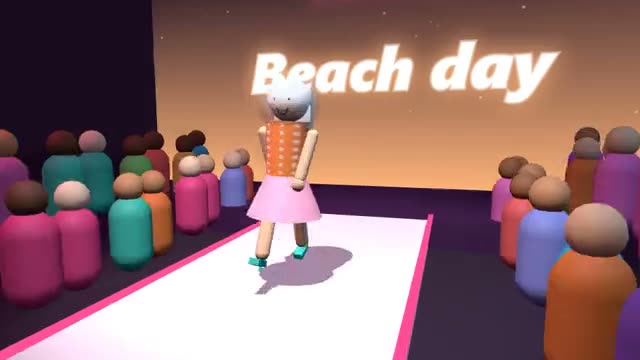

# Runway

Dress for the theme. Own the runway. A multiplayer starter game from [Multiplayer Agent](https://multiplayeragent.com): 3D, party, 2–10 players, with bot models that fill empty spots.

## How it plays

A theme is announced, then you have 90 seconds in the dressing room to pick hair, top, bottoms, shoes, an extra and colors. Every model walks the runway and strikes a pose while everyone else rates the look 1 to 5 stars. Best average takes the podium.

Pieces that suit the theme are marked "on theme" in the dressing room. The bots like those, so wearing them pays off, but your friends can vote however they like.

**Controls:** Tap or click pieces and colors to dress, drag to turn your model, tap stars (or keys 1–5) to rate.

## Make it yours in the Game Builder

Open the [Game Builder](https://multiplayeragent.com), choose **Start from a starter game** and pick Runway. It opens as version 1 in your studio, ready to play and publish. Then ask for changes, for example:

- Add a pirate theme with hats and eye patches
- Let the winner pick the next theme
- Add a mirror selfie photo you can download

## Run it yourself

1. Get a free publishable key (`pk_…`) at [multiplayeragent.com](https://multiplayeragent.com).
2. In `index.html`, put it in place of `pk_REPLACE_ME` in the `MP_CONNECT` block.
3. Serve the folder (for example `npx serve`) and open it. The 3D engine loads as a module, which browsers block from a file on disk.

Without a key it still runs, offline with bot models.

## How it is built

- One `index.html` plus three.js in `libs/`. The comment at the top of the script maps the code and explains the multiplayer.
- **Host-run rounds:** One player's browser announces the theme, runs the walks and adds up the stars; if it leaves, the next player takes over.
- **Bots:** Bot models dress for the theme, walk and rate the others until enough people join.
- **Live sync:** Everyone sees the same model on the runway, in the outfit its owner picked.
- **Leaderboard:** Each player's best average stars.
- Every piece of clothing is built from simple shapes in code (no image or model files). The wardrobe list at the top says which themes each piece suits.
- `?attract` runs it offline with bots only. The preview video is recorded from it.

## License

MIT.
